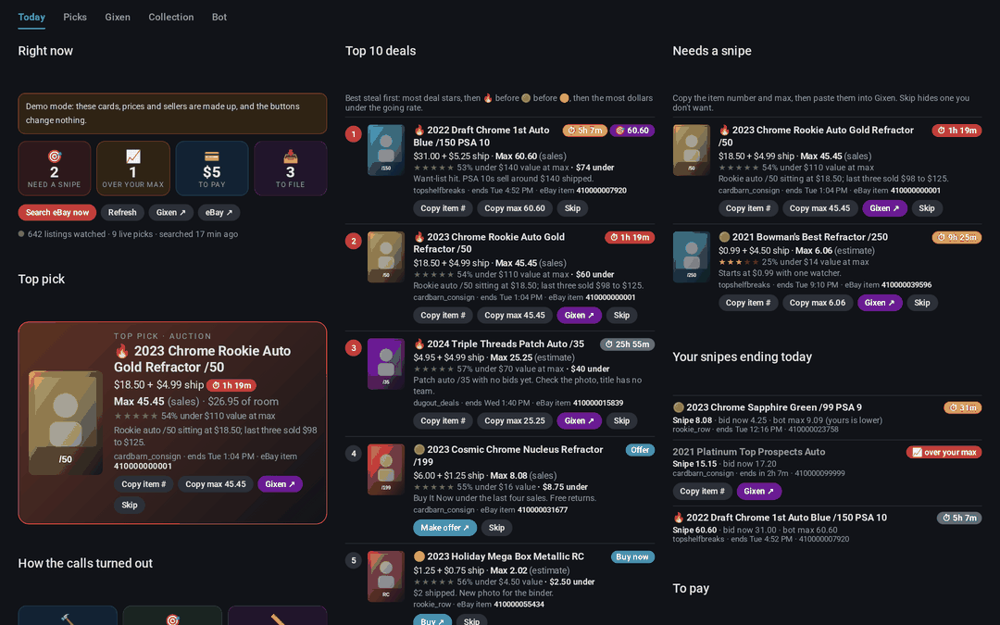
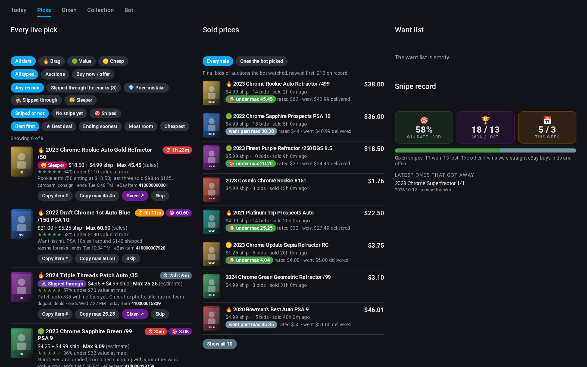
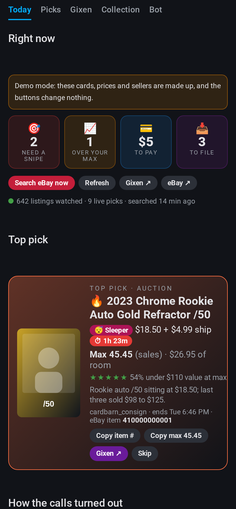
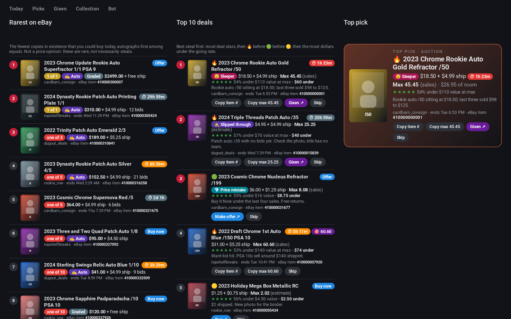
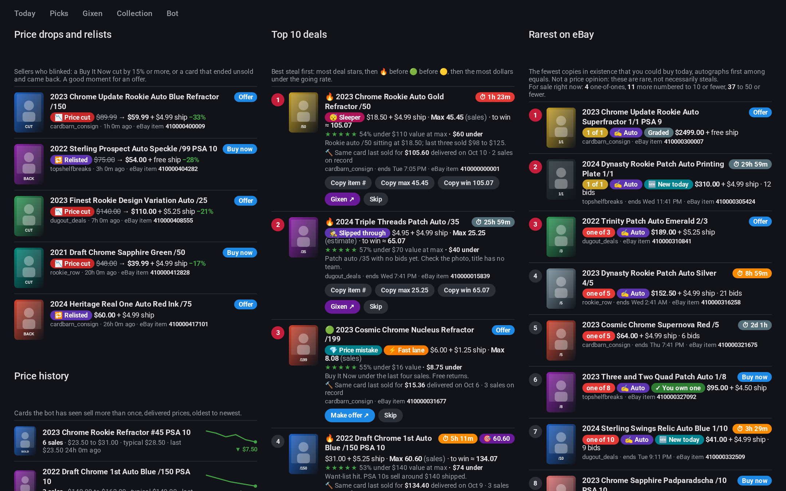

<p align="center"></p>

# Snipe Hunt

[](https://github.com/jordanwalk193/snipe-hunt/actions/workflows/ci.yml)
[](LICENSE)

A self-hosted bot that hunts eBay for underpriced cards of **one player you collect**, or **every player on one team**, and tells you what to snipe and for how much.

Every hour it searches eBay (including misspelled listings), throws out everything that isn't your player, and has Claude compare what's left with your inventory, your want list and recent sold prices. The steals come to your phone with a suggested max bid, and to a Home Assistant dashboard.



<sub>Screenshots show the built-in demo data. Every card, price and seller in them is made up.</sub>

**Snipe Hunt only recommends.** It never bids, buys, makes offers, messages sellers or changes a Gixen snipe. It has no code that can.

## What it does

- **Finds steals.** Auctions ending soon, new Buy It Now and Best Offer listings, autos, patches, numbered cards, and typo listings other buyers miss.
- **Knows what you own.** It skips cards already in `inventory.csv` unless a copy is clearly better.
- **Sets a max.** Each pick comes with a snipe price where winning still beats recent sales, shipping counted, and says whether that came from real sales or an estimate.
- **Learns what cards sell for.** After every auction it has seen closes, it asks eBay what the final bid was and keeps it, along with Buy It Nows that sold at their listed price. The next time the same card comes up, the price comes from that sale and not from a guess. See [Gets smarter over time](#gets-smarter-over-time). The dashboard lists the sales and keeps score: how many of its picks closed under the max it gave, and how far its going rate was from the real price.
- **Rates the deal.** One to five stars for how far under the going rate you would pay, shipping included: the asking price for Buy It Now, the max for an auction. Five stars is half price or better. A seller you already have an open order with, and who combines shipping, counts as $0 shipping.
- **Alerts your phone** through Home Assistant or [ntfy](https://ntfy.sh), with quiet hours and one "enter before bed" alert in place of overnight wake-ups. Before a held alert goes out its price is checked again, and the same card from several sellers arrives as one entry. Alerts are optional: without them, picks still reach the dashboard.
- **Watches limited drops.** A daily check for Topps Now and other print-to-order cards of your player, and a weekly check of new product checklists.
- **Keeps the inventory current** from your eBay and Gixen emails (optional, read-only).
- **Shows your Gixen snipes** next to its own picks, so you can see which good auctions have no snipe yet (optional, read-only).
- **Hunts for what slipped through the cracks**: price mistakes on Buy It Now listings, cards hidden by a misspelled or thin title, and auctions about to end with nobody watching. Each one is labelled on the dashboard and leads the phone alert.
- **Finds cards listed without the player's name**: it learns your player's card numbers from the listings it has seen ("2020 Bowman Draft BD-57"), searches for those, and keeps the ones that leave the name out. Nobody searching for the player sees them.
- **Watches for sellers who blink**: a Buy It Now cut by 15% or more, or a card that ended unsold and came back. No Claude cost.
- **Gives two bids for every auction**: the cheapskate max, and a "to win" bid at about the going rate, for the card you would rather own than steal. The scorecard shows how each would have done.
- **Has a fast lane for price mistakes** (off until you turn it on): every few minutes it checks brand-new Buy It Now listings and scores only the ones worth a look.
- **Keeps a price history per card**: every card it has seen sell more than once, with the trend, and "same card last sold for" on each pick.
- **Checks your Gixen amounts**: reads the snipes you set (never changes them) and says how each amount sits against the card's going rate: over it, a fair bid that should win, a real discount, or a long shot. A card it has no price for gets one Claude appraisal, kept so it is paid for once.
- **Jackpots get the loudest alert it has.** A card worth $20 or more for a sliver of that (20% or less delivered, 12% if the value is only an estimate) skips every alert setting and quiet hours: one time-sensitive alert of its own, "buy it now, think later", and a banner at the top of the dashboard. Auctions count only in their last two hours, at the current bid. Fake autos, unverified prices and new or doubtful sellers never qualify.
- **Says what to offer on stale listings.** A Buy It Now with Best Offer that has sat 30 days or more usually takes well under its asking price. The bot lists those (cards you don't own, $3–$300) with an odd-cent amount to send: 70% of the ask, never over 80% of what the card goes for less shipping, and nothing when a fair offer would be under half the ask (it gets declined). You send it yourself; the bot never makes an offer.
- **Lowball snipes.** Most cheap auctions of a good card end near its going rate; a few end far under it, mostly ones few bidders see. Every auction of a card worth $15 or more that is still under half its going rate and ends within two days gets one low snipe, marked when it ends at a dead hour (overnight, a holiday, the Super Bowl) or is easy to scroll past (shipping not stated, high shipping, ships from abroad, no photo). The snipe level starts at 35% of the going rate and is learned from how these auctions end, so about one in five would win. **Last call**: half past each hour, the targets ending within three hours that are still under 30% of the going rate with at most one bid go to your phone. That job never calls Claude and makes no eBay call when nothing is ending.
- **Second-guesses your snipes.** Besides the price, each Gixen snipe is checked for the wrong player, a card already in your inventory (same year, number, parallel, print run and graded or not), the same card sniped twice, a CCG slab, an auction the bot looked at and passed on, and a new seller. The serious ones, and a snipe over the going rate by $3 or more, are sent to your phone once.
- **Ranks the rarest cards for sale**: the ten lowest print runs on eBay right now (1/1s, then /5, /10 and so on), read from the listing titles on every search at no Claude cost.
- **Writes a weekly report**: wins and losses, what to pay, what to file, best upcoming snipes, and what the week's auctions sold for.
- **Knows your spending.** From what you paid and when (`price_paid`, `order_date` in the inventory): spend by month, this month's pace against your budget, what you usually pay for an auto, a graded card, a numbered card or a base card, and a forecast of next month's spend and the likely price of your next card. On the dashboard, in the weekly report, and as "you usually pay" next to each pick.
- **Follows a whole team** if you'd rather: [team mode](#team-mode) hunts every player on, say, the St. Louis Cardinals, filters the thousand-plus new listings an hour for free, and spends Claude only on the most likely steals, within a daily budget.
- **Reviews and tunes itself.** A weekly self-review of its own numbers proposes fixes, and may adjust one bounded setting a week and put it back if things get worse. It never changes its own code. See [How it improves itself](#how-it-improves-itself).
- **Shows what it costs.** Every Claude call's cost is added up per day and month and shown on the dashboard.

<p>







</p>

## Try it in two minutes

Demo mode serves made-up data, so you can see the dashboard before you have any keys. It never touches eBay or Claude and sends no alerts.

```
git clone https://github.com/jordanwalk193/snipe-hunt && cd snipe-hunt
docker compose -f docker-compose.demo.yml up -d
```

Then add the [Home Assistant integration](#home-assistant-dashboard) with the address `http://<this machine>:8766` and the token `demo`.

## What you need

- eBay developer keys (free, [developer.ebay.com](https://developer.ebay.com)). A Production keyset stays disabled until you answer eBay's account-deletion notification; see [eBay's deletion endpoint](#ebays-deletion-endpoint).
- An [Anthropic API key](https://console.anthropic.com) for scoring. This is the running cost: one scoring call an hour for new listings, plus a few web lookups. The dashboard shows what you've spent today and this month, so watch it for the first day or two.
- Somewhere to run it: Docker, or any Linux box with Python 3.11+.
- For the dashboard: Home Assistant with [HACS](https://hacs.xyz).

## Quick start with Docker

```
git clone https://github.com/jordanwalk193/snipe-hunt
cd snipe-hunt
cp .env.example .env        # then fill it in
docker compose up -d
```

After the first tagged release, the image is also published for amd64 and arm64 (a Raspberry Pi works) at `ghcr.io/jordanwalk193/snipe-hunt`: use the `image:` line in `docker-compose.yml` in place of `build: .` to skip the build. Changes are listed in [CHANGELOG.md](CHANGELOG.md).

The first start creates `home/data/` with starter files. The first search finds everything on eBay at once, so it sends a single welcome alert rather than one per pick; after that you only hear about new listings.

Edit these, then `docker compose restart`:

| File | What it is |
|---|---|
| `profile.toml` | Who you collect and how to tell their cards from everyone else's |
| `inventory.csv` | Every card you own or have coming |
| `wantlist.md` | What you're chasing and your price ceilings |
| `preferences.md` | How you buy, written like a brief to a friend bidding for you |
| `musthave.md` | Optional. The defining cards of each year, with an eBay search and a rule for which inventory rows count as owning each. The dashboard shows which you have, how many are for sale and the cheapest, and Make an offer puts these first. Start from `examples/musthave.example.md` |
| `rainbow.md` | Optional. Every parallel of a card you rainbow-chase: which you have, which are for sale now and live picks. Start from `examples/rainbow.example.md` |

A few `preferences.md` lines worth keeping (they are in the example file), because they stop the most common bad pick, a slabbed signature priced like a pack-pulled auto:

```markdown
- **Signed base cards aren't autos.** A BAS/JSA slabbed signature on a paper base card is worth maybe $20–30 at most. Never tier one "fire".
- **Buy It Now needs real comps.** A Buy It Now over $25 needs real comps; if the value is an estimate, say so and give it 3 stars at most.
- **Watch new sellers.** Be skeptical of sellers under about 100 feedback on anything over $30.
```

Check the setup (this never prints secrets):

```
docker compose exec snipe-hunt python -m snipehunt check
docker compose exec snipe-hunt python -m snipehunt.ebay_search --dry-run
```

The second command runs a real search and prints what it found without scoring or alerting. It's the fastest way to tune your profile.

## Setting up your player

Only the name is required:

```toml
[player]
name = "Paul Skenes"
```

From that, Snipe Hunt works out typo spellings and typo searches. It gets much sharper when you add a few lists, because many players share a name with someone in another sport:

```toml
collector = "Alex"

[player]
name = "Paul Skenes"
about = "the Pittsburgh Pirates pitcher"
sport = "baseball"
team_words = ["pirates", "pittsburgh", "lsu"]
card_words = ["topps", "bowman", "mlb"]
wrong_words = ["football", "basketball"]
```

How a title is judged:

1. Any `wrong_words` → dropped.
2. The player's name plus a team word, a card word or the sport → a sure match.
3. The player's name alone → "unclear", and Claude decides while scoring.
4. Just the last name plus a team word → "unclear", unless it's one of `other_first_names`.

`examples/profile.example.toml` is a complete, commented profile.

**Memorabilia and listings without the name.** Every search keeps only titles that name the player, so a team-signed ball or a photo of a famous moment that never names them is dropped. List searches for those under `[search] loose`. A result whose title leaves the name out is handed to Claude to judge instead of being dropped, though `wrong_words` still rule it out:

```toml
[search]
category_id = ""     # every eBay category, not just card singles
loose = ["1976 flag dodger stadium", "1981 dodgers team signed"]
```

**Everything already listed.** The hourly searches read the first 100 results of each search: everything new in an hour, but not what was listed before the bot started. A one-off backfill pages through it all (eBay allows up to 10,000 per search) and scores what isn't scored yet. Its picks go to the dashboard and the sheet with one note, not an alert each:

```
python -m snipehunt.jobs backfill --pages 50 --skip-category 261328   # only what isn't a card single
```

## Team mode

Follow a team instead of a player: every card of the St. Louis Cardinals, whoever is on it, cheapest steals first.

```toml
[team]
name = "St. Louis Cardinals"
roster = ["Jordan Walker", "Masyn Winn"]   # optional: players to put first
```

`python -m snipehunt init --team` starts from [`examples/profile.team.example.toml`](examples/profile.team.example.toml). One bot follows a player or a team, not both; run a second copy for the other.

A team lists about 85 times as much as a player (1,128 new Cardinals listings in an hour against 13 for one of their players), so team mode filters for free before anything is paid for. It drops lots, breaks, cards you own, cards outside your price band and plain base cards. It ranks what is left with evidence of a steal first: under a recorded sale of the same card, a price cut, an auction ending with no bidders, a misspelled title. Then come autos, patches, low print runs and your roster. Only the top 30 go to Claude, within a daily budget ($5 by default; both can be changed in Home Assistant). Measured on a live run: 2,060 listings, 30 scored, 10 picks, $0.31.

It also finds sellers with several cards worth having (one shipping charge), holds every want-list ceiling in code, and learns: a player Claude finds on another team's cards (the NFL Cardinals, say) is ruled out for free from then on. The dashboard gets a "best deals for the Cardinals" board, sorted by discount, with a per-player view. Everything else (deal stars, the cheapskate max, the "to win" bid, sold prices) works as in player mode. Details in [`docs/TEAM_MODE.md`](docs/TEAM_MODE.md).

## Mid-tier steals lane

A lane of its own for $20–$80 cards whose listings get them wrong: the name misspelled, the autograph or parallel only in the item specifics, the wrong year, the wrong category. Those are the cards most buyers never see. It is **recommend only**, like the rest of the bot: it searches and reads single listings, and never bids, makes an offer, buys, or touches Gixen (`tests/test_safety.py` checks the source for that).

Each hour it searches the player's misspellings first, then the name, then the keyword searches in turn: auctions ending in the next 36 hours (`price:[..80]`; a $9 bid today can still be a $30 card), and Buy It Now / Best Offer listings at $20–$80, both in category 261328. eBay's price filter isn't always exact, so the band is checked again on what you would actually pay, shipping included. Reprints, customs and "you pick" listings are dropped. A listing that already shows a sign of being mislabeled, or whose recorded sales already put it within reach, has its item specifics read (within a daily budget), and the detectors run:

| Signal | Weight | Fires when |
|---|---|---|
| `typo_name` | +3 | the title misspells the player ("Jordon Walker") and never spells it right |
| `hidden_auto` | +3 | the specifics say Autographed: Yes, or a Hard Signed / On-Card / Sticker autograph, and the title doesn't say auto |
| `hidden_parallel` | +2 | a print run, serial or parallel in the specifics or description that the title leaves out |
| `year_set_mismatch` | +2 | the title's year doesn't fit its card number (`data/known_cards.toml`) |
| `year_drift` | +1 | a known, harmless year mix-up (BHP-52 listed as 2023) |
| `wrong_category` | +1 | listed outside Sports Trading Card Singles |
| `thin_listing` | +1 | one photo, a title of seven words or fewer, or no Card Number in the specifics |
| `odd_end_time` | +1 | an auction ending 1:00–6:59 AM Eastern; a tiebreaker only, never enough alone |
| `facsimile_guard` | −5 | says auto, isn't one: Autographed: No, a facsimile or printed signature, a Platinum Anniversary base card, a reprint |
| `too_good_new_seller` | −3 | under 50 feedback and asking under 40% of the going rate |

Only listings with more weight for than against, and at least one sign that isn't the end time, go to Claude. Claude is shown the signals and the specifics, is told to pin the card down (year, set, number, parallel, serial, grade) before using a comp, and to say "unsure" when it can't. Then the lane decides for itself:

- **Value**: recorded sales of the exact card first (see thin comps below), else Claude's value.
- **Max**: `rec_max = min(deal_ratio × value − shipping, max_pay − shipping)`, as an odd-cent cheapskate snipe (35.35, 47.47), never above `rec_max`. A Buy It Now shows "BIN ok ≤ $X" instead, and a Best Offer listing an "offer idea" at 85% of that, as text only.
- **Alert** only when `rec_max` plus shipping reaches `min_pay`, the price you could pay right now (the next bid, for an auction) is within `deal_ratio` of the value, Claude was sure of the card, and the signals still say mislabeled. A printed signature holds the alert back unless real sales of the unsigned card still make it a deal.

```
🎯 MIDTIER ★★★★ 2021 Bowman Chrome Jordon Walker Atomic Refractor
900000000001
Max: 35.35  (value ~$62 from 3 sold comps; ship $4.99)
Ends: Tue 3:12 AM ET / 12:12 AM PT
Why: typo_name("Jordon"), hidden_parallel(/150 in specifics, not title), odd_end_time(Tue 3 AM ET)
Watch-outs: none
https://www.ebay.com/itm/900000000001
```

The item number sits alone on its own line so it pastes straight into Gixen. Quiet hours hold these like any other alert, and a daily "midtier summary" counts what was searched, read, flagged and alerted, and the eBay calls it took.

Turn it on with `[search.midtier]` in the profile (the example profile has it, with every key and its default); without that block the lane is off. Home Assistant can switch it off and change `deal_ratio` and `max_pay` (settings `midtier_enabled`, `midtier_deal_ratio`, `midtier_max_pay`).

| Key | Default | |
|---|---|---|
| `enabled` | true | |
| `min_pay`, `max_pay` | 20, 80 | the band, on what you'd pay with shipping |
| `category_id` | "261328" | Sports Trading Card Singles |
| `auction_window_hours` | 36 | |
| `deal_ratio` | 0.60 | alert at 60% of the going rate or less |
| `min_comps_for_5_star` | 3 | |
| `getitem_daily_budget`, `search_daily_budget` | 120, 400 | eBay calls a day for this lane |
| `odd_hours_et`, `odd_weekdays` | [1, 6], Mon–Thu | both hours included |
| `thin_listing_max_title_tokens` | 7 | |
| `new_seller_feedback_below` | 50 | |

**API budget.** eBay gives an app 5,000 Browse calls a day for everything. The lane spreads its 400 searches over the day (about 17 an hour, misspellings and the name every hour, keyword searches taking turns) and reads at most 120 listings in full; a listing read once is not read again that day. The other lanes come first: past 80% of the day's calls the lane is the first to stop.

**Known limits.** The Browse API has no sold prices, so values come from the bot's own ledger (which fills up over weeks) or Claude's estimate, and a guess is capped at three stars. The odd-end-time signal is weak and only ever tips a close call. Item specifics are written by sellers and can be wrong too.

## Steals mode and the brag board

For the frugal collector: only cards you can get for half their value or less, and a board to brag about how cheaply you got them. Steals mode is **recommend only**, like the rest of the bot: it reads listings and sends alerts, and never bids, buys or touches Gixen.

Turn it on with a `[steals]` table in the profile (the example profile has it, commented out); without it the bot works exactly as before. With it:

- **Half of value at most.** Every pick is held to `max_share` of its going rate, shipping counted: an auction's max is cut to an odd-cent snipe that wins at that share, and a Buy It Now over it is no pick. Claude is told the rule too. Want-list cards keep their own ceilings.
- **Cheap cards only.** Listings costing more than `max_landed` delivered ($75 for an autograph), and the high-end noise a frugal collector never wins cheap (1/1s, superfractors, printing plates), are dropped before anything is scored, so Claude's time goes where steals are.
- **Bid now, think later.** An auction ending within the hour whose current bid plus shipping is 10% of its value or less gets one time-sensitive push, after a fresh read of its bid. The fast lane checks every run, and the between-hours job runs whenever an auction is on the list.

```
⏱️ BID NOW: $40 card for $2.25, ends in 18 min
2023 Topps Chrome RC Refractor #209
94% under its value. Bid now $1.25 · 2 bids · ends 9:42 PM.
Worth about $40.00 going by recorded sales.
Bid up to 18.18. Bid now, think later.
Item 900000000001
```

- **Just dropped.** A Buy It Now a seller cuts into steal range within the last day gets one push ("📉 JUST DROPPED: $30 card now $8.00 delivered").

Everything here is cross-referenced with `inventory.csv`: a listing you already bought (its eBay item number is in the inventory) or another copy of a card you own never shows in these lists or alerts, using the same careful match as lowball snipes and offers (same year, card number, parallel and print run; a graded copy of a raw card counts as an upgrade and still shows).

Every bot also gets these dashboard lists, steals mode or not (read-only, nothing is sent):

| Snapshot key | What it is |
|---|---|
| `bid_now` | auctions ending within the hour at 10% of value or less, **soonest ending first** |
| `radar` | the ten listings closest to a jackpot or bid-now line, **soonest ending first** (Buy It Nows after), with how far each is from the line and when its alert window opens |
| `bundles` | two or more picks from one seller, added up with shipping paid once where the seller combines it, and the Gixen lines for a group snipe |
| `savings` | bought picks (inventory rows with an eBay item number): paid against value, this month and in all, and the best buy |
| `dropped` | Buy It Nows cut into steal range in the last day |
| `brag` | the brag board, below |

**The brag board.** From the cards you bought: total saved, the five biggest steals, a steal of the month, a weekly streak (weeks in a row with a buy at half price or better), and badges: **90% Club** (paid 10% of value or less), **Dollar Store** (a $10+ card for a dollar or less) and **Half-Off Hero** (half price or less). It ends in the weekly report too, with a brag card ready to paste on a forum:

```
🏆 Snipe Hunt brag board, October 2026
Saved $106.80 on 5 cards (paid 17% of value)
Best steal: 2023 Topps Chrome RC Refractor #209: paid $2.02, worth $24.00 (92% off)
90% Club ×2 · Dollar Store ×1 · Half-Off Hero ×5
Steal streak: 5 weeks
```

The brag card holds card names, prices and percentages only: no seller, item number, order date or anything from your settings.

| Key | Default | |
|---|---|---|
| `enabled` | true | `false` keeps the table but turns steals mode off |
| `max_share` | 0.50 | 0.3–1.0; Home Assistant can change it (setting `max_share`) |
| `bid_now_alerts`, `drop_alerts` | true | Home Assistant can switch each off |
| `max_landed`, `max_landed_auto` | 25, 75 | the delivered ceiling, and an autograph's |
| `skip_words` | 1/1, superfractor, printing plate… | titles with these are dropped |

## All-lane improvements

These apply to every search, not just the mid-tier lane.

- **Junk filter.** Titles with `reprint`, `rp`, `custom`, `digital`, `facsimile`, `proxy`, `art card`, `you pick`, `pick your`, `u pick` or `complete your set` are dropped before scoring, so they cost nothing. Change the list with `[search] junk_words`; lots stay in unless you set `lots = false`.
- **Fake autographs.** A title that says auto on a card that isn't signed (item specifics say Autographed: No, a facsimile, printed or pre-printed signature, or a Topps Chrome Platinum Anniversary base card without an autograph card number or "Autographs" set name) is kept but flagged. Scoring is told to price it as the unsigned card, its comps come from unsigned sales, it can't be 🔥, and its "why" starts with "printed signature, not an auto".
- **New-seller scam guard.** Under 50 feedback and paying under 40% of the going rate is flagged "too good for a new seller", and alerts only when the value comes from recorded sales and the total is one a new seller is trusted with (`SELLER_TRUST_OVER`, $30).
- **Category and condition.** Every search is limited to category 261328 unless the profile's `[search] category_id` says otherwise (`""` searches everywhere, where lots are often listed). eBay's condition (2750 graded, 4000 ungraded) and photo count are read from every result, and scoring is told graded or raw so comps match.
- **One price filter.** Every price filter is written by `ebay_search.price_filter()`, which always adds `priceCurrency:USD` (without it eBay answers error 12012); a test checks no other code writes one. Prices are checked again after the search.
- **API budget and lane priority.** Every eBay call is counted by lane (auctions-ending and newly-listed as "core", keyword, typo, extra, sellers, hidden, midtier, item reads, aspects), and the counts are in the weekly self-review. The daily cap is the setting `ebay_daily_cap` (5,000, eBay's default). Past 80% of it a warning is logged and lanes stop in this order: midtier and extra searches at 80%, hidden at 85%, typo at 90%, keyword at 95%; the two main searches and sold-price look-ups only at the cap. A rate limit (HTTP 429, or eBay's "call limit" error) gets two retries with backoff, then that lane waits for the next run. A live listing read once is answered from the database the rest of that day; after it ends it is always read fresh, since sold prices depend on the final answer.
- **Thin comps.** Recorded sales of the exact card (same number and year, same set and parallel words, same print run, autograph and grade, graded against graded) come before Claude's value. One sale caps a pick at three stars; two use the lower of their median and the newest, and cap it at four; three or more allow five. When every sale is more than 180 days old, one more star comes off. The comps line starts "N sales, newest YYYY-MM-DD". A guess stays capped at three, as before.
- **Card years: `data/known_cards.toml`.** Card number to product and year, with the usual mix-ups: BA-JW1 is in five Leaf products and only gets a year when the title names one (All-American, National Showcase, Valiant, Metal); FMF-10 is 2021 Bowman Chrome 40-Man Futures; BHP-52 and BHPC-52 are 2022 Bowman Heritage released in 2023, so "2023" is drift, not a different card. `init` copies [`examples/known_cards.example.toml`](examples/known_cards.example.toml); the inventory's own card numbers and years are added on their own (the file always wins), and the card-number searches use every number the file pins to one year.
- **eBay's own field names.** Once a week (setting `aspect_refresh`, on by default, one call) the bot asks eBay which item-specifics names and values it uses for the player's cards and keeps them; the detectors look names up there instead of guessing.
- **More sold prices.** Your own wins from email (eBay "You won", Gixen end notices) are added to the ledger, one per item number, marked as yours; a price the bot looked up itself is kept over the email. Enter one by hand with `python -m snipehunt sale add <item_id> <price> <ship> "<title>"`. The sold block in the scoring prompt says where each price came from.
- **Alerts.** End times in Eastern and Pacific ("ends Tue 3:12 AM EDT / 12:12 AM PDT"), the item number alone on its own line, an odd-cent max on every auction pick (D dollars and D cents, never above the max; a want-list ceiling is kept as you typed it), "BIN ok ≤ $X" on Buy It Nows and an "offer idea" on Best Offer listings (text only), and a "Watch-outs:" line on every alert: printed signature, new seller, thin listing, too good for a new seller, guessed price, or "none".
- **Inventory check.** `python -m snipehunt inventory check`, and a section of the weekly report, list problems without changing the CSV: possible duplicates (same card, serial, seller and order date, or notes saying "Same item as"), Delivered rows older than 14 days, In transit past a due date in the notes, years that don't fit `known_cards.toml`, missing card numbers and item ids, the trade pile (dupe=Y), and a front page that isn't exactly 9 cards.
- **Win messages.** The daily email sync announces each new win once, with "Binder: 2021 → pp4–5". When the title's year is wrong and the card number says otherwise it uses the real year and says so; when the year came from the title alone it adds "check the back of the card".
- **Combined shipping.** When two or more open wins or unpaid orders are with one seller, you get "<seller>: N wins, wait for one combined invoice before paying.", at most once a day per seller, and no more once they are paid.

## The schedule

One process runs everything. Times are in `SNIPEHUNT_TZ`.

| When | What |
|---|---|
| Every hour, on the hour | Search, score, alert; offers to send, lowball snipes, snipe warnings; the Google Sheet push, if set up |
| Half past each hour | Fresh bids on good picks ending within three hours, and lowball last call; only when one of those is due (no Claude) |
| 9:00am | Limited-drops check, inventory sync from email, win messages, combined-shipping reminders, the mid-tier summary |
| Sunday 6:45pm | Weekly report (with the inventory check; the first Sunday adds a value check, duplicates and grading candidates), eBay field names refresh |
| Sunday 7:30pm | Weekly self-review; see [How it improves itself](#how-it-improves-itself) |

Run any of them by hand, with `--dry-run` to see what it would do:

```
docker compose exec snipe-hunt python -m snipehunt.jobs hourly --dry-run
```

## Gets smarter over time

Nothing here needs setting up. The longer the bot runs, the more it has to go on.

- **Where steals happen.** From its own ledger the bot learns how auctions close by seller and by ending hour, and says so on each auction pick and alert. On the bot this was measured on, a consignment seller's auctions (ten or more sales on record) closed at 136% of the going rate and the bot's max won 15% of the time; a one-off seller's closed at 82% and the max won 44%; and at those small sellers a daytime ending (8am–8pm) closed at 77% of value with half the bids of an evening one. So a 🧊 quiet seller or daytime ending is where a cheapskate max is likely to win, a 🔥 hot seller is where it rarely does, and lowball snipes skip hot sellers. The snapshot's `closes` key carries the learned table.
- **An auction's Buy It Now.** Some auctions are listed with a Buy It Now that disappears at the first bid. The bot reads it, names it in the alert ("Or Buy It Now $4.00: about the max, buy it"), and a cheap one is a jackpot at once.
- **"Added to Gixen."** Gixen's list is read once a run, so a snipe you set a minute ago isn't on the dashboard yet and a card can get sniped twice. The `sniped` action marks a pick as covered the moment you set it; the mark gives way to the real snipe when Gixen shows it.
- **Sold prices of its own.** Every auction it has seen is looked up once after it closes, and the final bid is kept for good: the ledger only grows. That includes auctions it never found itself: every snipe in your Gixen list for your player is noted, so its closing price is recorded too.
- **Buy It Now sales that are clean.** A fixed-price listing that takes no offers can only sell at its listed price. Once one drops out of the search the bot asks eBay whether it sold, and keeps it as a fixed-price sale (marked BIN). Anything with Best Offer is never recorded, because the price it really went for isn't shown.
- **Comps that are the same card.** A sold price counts for a listing only when the grade, autograph and print run match. The same card number and year match even when the titles share few words, and a different card number never matches. A sale of another grade or print run is shown to Claude as a hint, one per listing, marked "(different grade/parallel)".
- **Your taste.** When you hide a pick, the bot keeps what it was. When you set a snipe, it keeps your amount next to its own max. Scoring is shown the latest fifteen of each, picks fewer cards like the hidden ones and more like the sniped ones, and leans toward your maxes where they keep running above or below its own.
- **"Bad pick" and "good call".** Each pick on the dashboard has a 👎 button that asks what was wrong (overvalued, wrong card, bad seller, don't want this type, already have it, or something else, with an optional note of up to 200 characters) and hides the pick, and a 👍 "good call" button that leaves it on the board. The bot keeps the pick as it saw it (tier, price, its value and max, whether that was from sales or a guess, the seller), the newest 300 at most. A snipe you set in Gixen on one of its picks counts as a quieter "good call", with your amount next to its max. The weekly report has a "Feedback this week" section: counts by reason, and each pick you marked overvalued with the bot's value next to what you said. Also available as the `feedback` API action and the `snipe_hunt.pick_feedback` service. Scoring is shown the newest twenty, fenced off and marked as data (a note can't give Claude instructions), with a rule to pick fewer cards like the ones marked overvalued or wrong card, or value them much lower, and more like the good calls. A new listing of the same card as one marked overvalued carries a note saying so.
- **Missed steals.** A sale it made no pick for that closed 35% or more under the usual price of the same card (at least two earlier sales) is a missed steal. The weekly report lists the week's ten biggest, the dashboard counts them, and scoring is shown the latest five as the kind of listing to watch for.
- **Corrections per price band.** Once enough of its picks have sold, the bot tells Claude how far off its going rates have been running, separately for cards valued under $10, $10 to $50 and over $50, since cheap and dear cards tend to miss in different directions.
- **It corrects its own guesses.** Telling Claude its values run low barely moves them, so the bot also corrects guessed going rates itself, after Claude answers. Per price band, it takes the median miss of Claude's raw guesses on picks whose auctions then sold, shrinks it toward no change while results are few (`n / (n + 10)`), applies it only once a band has 8 results and is at least `track_off` percent off, and holds it between x0.75 and x1.40 (`calibrate.py`). An auction's max moves with its value. Claude's own number is kept as `value_raw` and the correction is always learned from that, so it doesn't feed on itself. Values backed by real sales are never touched. The setting `calibrate` switches it off; the weekly report, the self-review and the snapshot (`calibration`) show the factors in use.

Where a sale didn't state its shipping, $5 is assumed, the same as everywhere else, and the total is marked as estimated.

## How it improves itself

Three levels, from fully automatic to one that waits for you. The rule across all of them: **the bot never changes its own code.** It can change a few of its own settings, inside fixed bounds; code changes only arrive as pull requests a person merges.

**1. A weekly self-review (automatic).** On Sunday evening, after the weekly report, the bot adds up its own numbers: how its picks sold overall and per price band, the steals it missed by type of card, how many picks you hid or sniped and how your maxes compare with its own, your Bad pick / Good call feedback counted by reason and tier (never the notes or card names), alerts sent, held and dropped as stale, what Claude cost per job and per pick, eBay calls per run, failed runs (with the Claude CLI's own failures named `ClaudeError`) and Gixen sign-outs, and your snipes on its picks by tier and price band: how many got one, won or lost, and what won snipes cost against its going rate. It shows them to Claude next to the four weeks before and asks what it is getting wrong and what the three to five most valuable fixes are, each with its evidence, expected effect, a way to measure it and its risk. The result is written to `reports/reflect-YYYY-MM-DD.md`. It also follows up the last four reviews: which proposals were done, and whether the metric each one aimed at moved.

The review sees numbers and nothing else. Listing titles, seller names and email text are written by strangers, so none of it is ever put in front of a prompt that can lead to a change. Claude gets no tools for this call: no web, no shell.

With `GITHUB_REPO` and `GITHUB_TOKEN` set, the week's proposals also go to one GitHub issue, "Weekly self-review YYYY-MM-DD", labelled `self-review`, as a checklist. Use a fine-grained token for that one repository with **Issues read and write only**. Without a token you get a short phone alert that links the report. On a public repository the issue is public, and it holds your week's numbers (counts, percentages, Claude cost).

**2. Bounded self-tuning (automatic, reversible).** The review may change one setting a week, from this list and no other, inside these bounds:

| Setting | What it does | Default | Range | Most it moves in a week |
|---|---|---|---|---|
| `edge_min_pct` | How far under the going rate a card must be to be called a price mistake, hidden or a sleeper | 25 | 15 to 40 | 5 |
| `min_overlap` | Share of title words a sold price must share with a listing to count as a comp | 0.5 | 0.4 to 0.7 | 0.05 |
| `track_off` | How far off the going rates must run before scoring is told | 10 | 5 to 20 | 5 |
| `price_lookups` | Sold-price web lookups per scoring call | 8 | 0 to 12 | 2 |
| `fast_min_price` | Asking price at which a plain card is worth a fast-lane call | 15 | 5 to 30 | 5 |
| `yellow_max_total` | The cheap-card alert limit | 2 | 1 to 4 | 0.5 |

Every change is logged with its reason and the metric it is judged by, measured over the four weeks before. Two weeks later the metric is measured again. Worse by more than noise (15% of itself, and at least 3 points) and the setting is put back. Fewer than 8 results before or after is "inconclusive, keep watching", for up to six weeks. A setting you have changed by hand since is never put back. The log is on the dashboard and in the weekly report, and the `self_tuning` switch freezes all of it. Never tunable: anything about the read-only rules, quiet hours, which alerts are on, credentials or how the bot signs in to Gixen.

**3. A monthly improvement pull request (you approve).** [`docs/SELF_IMPROVE.md`](docs/SELF_IMPROVE.md) holds the instructions for a Claude Code session, run by you or on a schedule and never by the bot itself: read the open `self-review` issues and the last four reviews, pick the single most valuable code proposal, implement it with tests on a branch, and open a pull request with the problem, the evidence, how to measure success and how to roll back. It never merges and never pushes to main. `make improve` prints the instructions.

`tests/test_guards.py` runs in CI on every pull request and fails if a read-only guard goes missing: Claude's tool limits, the "never bid or buy" rules in the prompt, Gixen being read-only, the price check on every pick, the self-review having no tools. No pull request, including one Claude writes, can quietly drop them.

Run a review by hand, without changing anything:

```
docker compose exec snipe-hunt python -m snipehunt.jobs reflect --dry-run
```

## Alerts and quiet hours

- **Quiet hours** (11pm to 7am unless you change them) hold alerts until morning. A limited drop still comes through.
- **Bedtime bundle** (on by default): on the first search of quiet hours you get one alert, "enter before bed (N)", listing every alert-worthy auction that ends before quiet hours are over or within two hours after. Gixen does the sniping, so nothing wakes you for an auction during the night. Turn `bedtime_bundle` off for the older behaviour, where an auction ending within `urgent_hours` breaks through quiet hours.
- **Fresh prices.** A pick that was held overnight, or left over from a full run, takes the price from the latest search before it is sent. An auction already bid past its max is dropped, and so is a Buy It Now that has been out of the search for two hours.
- **One entry per card.** When several sellers list the same card, the alert shows the card once with a line per listing (price, shipping, end time, max, item number) and a reminder that a Gixen group bid covers them all.
- **Guessed prices are held back.** When no sales back a pick's value (its max says "estimate"), it can't be a 🔥 pick unless it's on your want list, and it gets three deal stars at most. A Buy It Now or best-offer listing priced from a guess and costing more than `estimate_bin_cap` ($25 by default, shipping included) never alerts: it still shows on the dashboard, flagged "unverified price". Alerts say "(guess, no sales found)" on the Max and Deal lines when the value is a guess.
- **Slabbed signatures aren't pack autos.** Scoring is told that a signed paper base card in a BAS/JSA/PSA-DNA "Authentic Autograph" slab is an in-person signature that sells for much less than a Chrome or Bowman auto, and that "Auto 10" or "Beckett 10" on such a label grades only the signature.
- **Seller trust.** Every alert names the seller with their eBay feedback ("Seller: cardshop · 4,210 feedback, 99.6%"), and scoring sees it too, with a rule to be skeptical of low-feedback sellers on anything over $30 and not to believe a condition field ("BGS 10") the title doesn't back up. A seller under `min_seller_feedback` (100 by default) caps a pick over $30 at 🟡 on the dashboard; it can still alert at the tier it would have had, led by "⚠️ new seller (N feedback)".
- **Combined shipping.** Scoring is told which sellers you have an unpaid or unshipped order with. For the ones named in `combined_ship_sellers`, the deal stars count $0 shipping and the alert says "combined ship w/ open order".

## Home Assistant dashboard

Install the [Snipe Hunt integration](https://github.com/jordanwalk193/ha-snipe-hunt) through HACS: add that address as a custom repository of type Integration, download it, restart Home Assistant, then add the **Snipe Hunt** integration. Give it the bot's address, `http://<bot machine>:8766`, and your `API_TOKEN`.

You get a five-tab dashboard, about fifty entities, an auctions calendar, and every setting as a switch or number: which tiers alert, the minimum deal rating worth an alert, quiet hours, the bedtime bundle, the cheap-card limit, a monthly budget, watched sellers, sellers who combine shipping and extra searches.

## Google Sheet

Optional: every hourly run can also write your hunt to a Google Sheet you own, for sorting, filtering and sharing. Tabs: **Summary** (cards kept, what you paid, spending by month with a chart, live picks, offers, lowball targets, Gixen totals, the median sold price), **Collection**, **Picks**, **Sold**, **Offers**, **Lowball**, **Snipes** and **Data Sources** (what each tab came from and when). The Summary is written once as formulas over the other tabs, so you can change it; the data tabs are rewritten on every push. Titles go in as plain text, so a listing title can never turn into a formula. Setup takes about five minutes: [docs/SHEETS.md](docs/SHEETS.md). Push by hand with `python -m snipehunt sheets`.

## Without Docker

```
git clone https://github.com/jordanwalk193/snipe-hunt /opt/snipe-hunt && cd /opt/snipe-hunt
python3 -m venv .venv && .venv/bin/pip install -r requirements.txt
npm install -g @anthropic-ai/claude-code
.venv/bin/python -m snipehunt init          # creates /var/lib/snipe-hunt
```

Put your secrets in `/var/lib/snipe-hunt/env` (same names as `.env.example`, mode 600), then install `deploy/snipe-hunt.service`. `SNIPEHUNT_HOME` moves the home folder.

If `data/` is a git repository, Snipe Hunt pulls before it edits the inventory and commits (and pushes, if there is a remote) after. Keep that repository private: it holds what you paid and what you're chasing.

## eBay's deletion endpoint

eBay disables a Production keyset until your app answers its Marketplace Account Deletion challenge at a public HTTPS address. `deploy/ebay_deletion.py` is a tiny standalone server that does exactly that and nothing else. Run it with `EBAY_VERIFICATION_TOKEN` and `EBAY_DELETION_ENDPOINT` set, put it behind your reverse proxy, and enter the same address and token on developer.ebay.com.

## Safety

- The API needs a bearer token on every request and can only do eight things: hide a pick, give feedback on a pick, restore hidden picks, mark cards filed, refresh, start a search, re-read Gixen, send a test alert.
- Claude reads listing titles and emails written by strangers, so it runs with web search and web fetch only: no shell, no file access.
- eBay is searched and single listings are read; nothing else. `tests/test_safety.py` fails the build if any module names an order, offer or checkout endpoint, writes to Gixen, or holds something that looks like a real token.
- Gmail and Gixen are read-only. Gixen allows one login at a time, so the bot and your browser sign each other out; after losing its session the bot waits two hours before signing back in.

## Questions people ask

**Will it bid for me?** No. It recommends a max and gives you the item number to paste into your sniper. There is no code in it that can bid, buy or make an offer.

**Is this allowed by eBay?** It uses eBay's official Browse API with your own developer keys and only searches. Sixteen or so searches an hour is far inside the default daily limit.

**What does it cost to run?** eBay's API is free. Claude is the cost, and it is not trivial: in the one setup this has run on, an hourly run that scored 48 new listings came to about $0.45 at API prices on the CLI's default model. About 40% of that was sold-price web lookups, and most of the rest was Claude reading the prompt and writing its answer. A quiet player costs far less; a busy one at that rate would be several dollars a day. Three things cut it:

- **Price lookups** (a setting in Home Assistant, 0 to 12, default 8): how many sold prices Claude may look up per run. At 0 it prices every card from what it knows and uses no web tools. In that same setup only about a third of the picks worth looking up ended with a real sold price, so fewer lookups costs less accuracy than you might expect. Replaying those 48 listings with lookups at 0 cost $0.25 and picked the same 9 cards, with lower maxes on three of them.
- **`CLAUDE_EFFORT=medium`** in `.env`: Claude thinks less before answering. On a replay of the same 48 listings it cost roughly a tenth less and found 8 of the same 9 picks, with two of them a tier lower.
- **`CLAUDE_MODEL`** in `.env`: a smaller model costs much less per run. Not measured here; compare its picks with the default for a day before trusting it.

Watch the dashboard's cost sensors for the first day before leaving it running.

A team bot is filtered for free first and capped by a daily budget; see [team mode](#team-mode).

**Does it work for football, basketball, hockey, Pokémon?** The searching and filtering work for any name, including a one-word name like "Charizard". There are example profiles for a football quarterback ([`profile.minimal.toml`](examples/profile.minimal.toml)), a basketball player ([`profile.basketball.example.toml`](examples/profile.basketball.example.toml)) and a Pokémon ([`profile.pokemon.example.toml`](examples/profile.pokemon.example.toml)), each with tests on titles of its kind. Pokémon cards aren't in eBay's Sports Trading Card Singles, so that profile sets `category = "183454"` (CCG Individual Cards) under `[search]`; any profile can. It has only been run for real on one baseball player and, read-only, on one baseball team so far.

**What is the fast lane and what does it cost?** A badly mispriced Buy It Now can be gone in minutes, long before the hourly search. Set `FAST_LANE_MINUTES=10` in `.env` and the bot makes one extra eBay search that often for the newest fixed-price listings. A listing it has never seen goes to Claude only when it is worth a look: numbered to 99 or fewer, an autograph, graded, an unclear title, asking $15 or more, or priced under a recorded sale of the same card. At most 12 listings a call and 30 calls a day, so the ceiling is a few dollars a day and most runs cost nothing. Everything else waits for the hourly run.

**Do I need Home Assistant?** For the dashboard, yes. Alerts alone work through ntfy without it.

**How little do I have to set up for another player?** A name, a sport and a few team words: see [`examples/profile.minimal.toml`](examples/profile.minimal.toml), a football quarterback in fifteen lines. Misspellings, searches and card numbers are worked out from there.

**Can it follow more than one player?** One player per bot, or one whole team with [team mode](#team-mode). Run a second copy with its own home folder and port for another.

**How good are the prices?** They get better the longer it runs. eBay blocks its sold-listings pages, so at first most prices are Claude's estimate, with a web lookup for the dearer cards. But the bot also records the final bid of every auction for your player that it saw close (one free eBay API call each, kept for good), and shows Claude the sales of the same card as the one being scored. Each pick says whether its max came from real sales or an estimate. A Buy It Now is recorded only when it takes no offers, because then it can only have sold at the listed price; one with Best Offer may have gone for a lower accepted offer, so it isn't counted. Treat the prices as a well-informed second opinion, and check anything expensive yourself. Once enough of its picks have sold, the bot also tells Claude how far off its going rates have been running in each price band, so the estimates correct themselves. More in [Gets smarter over time](#gets-smarter-over-time).

**Can I look up a price myself?** Yes. `python -m snipehunt sold gold refractor /50` lists every recorded sale with those words in the title, with the range and the typical price. With no words it lists the latest sales.

```
$ docker compose exec snipe-hunt python -m snipehunt sold gold refractor
2026-10-11 | $41.00 +4.99 ship, 14 bids | 2023 Topps Chrome Sam Example Gold Refractor /50 #45 RC
2026-10-04 | $36.50 +1.25 ship, 9 bids | 2023 Topps Chrome Sam Example Gold Refractor /50 #45

2 sales · $37.75 to $45.99 with shipping · typical $41.87
```

## License

MIT. See `LICENSE`.

## Development

```
pip install -r requirements.txt pytest
pytest
```

## Support

Snipe Hunt is free. If it finds you a steal and you'd like to say thanks:

[](https://paypal.me/jordanwalker1531)
